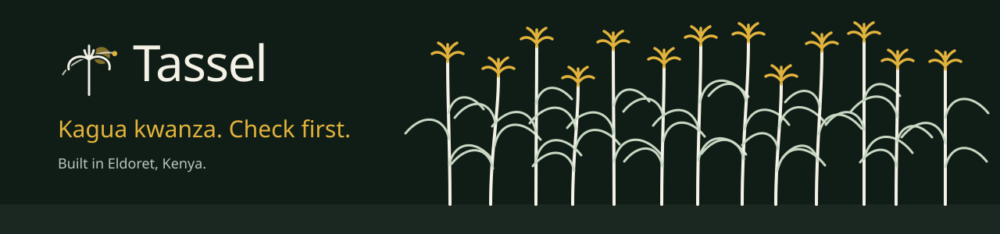

<p align="center">
  
</p>

<p align="center">
  <a href="#what-it-does"><b>What it does</b></a> &nbsp;·&nbsp;
  <a href="#screens"><b>Screens</b></a> &nbsp;·&nbsp;
  <a href="#the-model-honestly"><b>The model, honestly</b></a> &nbsp;·&nbsp;
  <a href="#run-it"><b>Run it</b></a> &nbsp;·&nbsp;
  <a href="#credits"><b>Credits</b></a>
</p>

Tassel is an Android app for smallholder farmers in Kenya. It answers two questions every morning: **how is my field doing, and what should I do today?** Formerly CropGuard AI.

<p align="center">
  
  
</p>

## What it does

**Your field from space.** Draw your shamba on the map once. Tassel reads every clear Sentinel-2 pass over it: crop vigour (NDVI) in 10 m squares, leaf water and a joint stress check in 20 m squares, each compared with that field's own normal. Home tells you in one sentence whether the field looks normal, and Field Health shows where to walk and look. This part needs a connection.

**Scan a leaf, offline.** The camera opens straight away. The disease model runs on the phone, so a scan works with no data bundle. The result is a plain name, a confidence word (Sure, Fairly sure or Not sure) and the next three steps. Below 75% the app says "Not sure", gives retake tips and offers an online photo check instead of guessing.

**What to do today.** At most three cards on Home: a task from your planting calendar, whether today is a spray day (wind, temperature and rain for that hour and the next six), an outbreak reported near you. No card when nothing matters.

**And the rest of the season:**

- **Planting, shown.** Advisory stages are swipeable picture cards with read-aloud: spacing, depth, rotation, what to watch for.
- **Fertiliser shopping list.** Your fields and sizes come in on their own. Pick a crop, get bags per product, swap a product, share the list.
- **Spray calculator.** Crop, then problem, then products registered for that use, then the label rate times your field. If the label rate cannot be verified, it says "See the label".
- **Outbreaks near you.** County totals only, and only when at least two farmers reported.
- **Prices.** Reference prices plus what farmers report, shown as the median.
- **English and Kiswahili** throughout, with read-aloud.

**Private by default.** No ads, nothing shared with third parties. Leaf photos stay on the phone unless you post them.

## Screens

<p align="center">
  
</p>

<sub>Real screenshots from a Tecno phone running version 2.7.0, 29 October 2026.</sub>

## The model, honestly

| | |
|---|---|
| Shipped model | v5, MobileNetV2 backbone, runs on the phone (TFLite) |
| Classes | 154, across 35 crop labels |
| Test accuracy | 94.04% on 16,254 held-out dataset images |
| Macro F1 | 0.9266 |
| Calibration error (ECE) | 0.0096 |
| Field accuracy in Kenya | **Not measured yet.** A blind field pilot with an agronomist is planned. |

The test images are lab and dataset photos, not Kenyan fields. Until the pilot is done, no field-accuracy figure is claimed anywhere.

## How it is built

| Layer | What |
|---|---|
| App | Expo SDK 57, React Native, TypeScript, expo-router |
| Motion and drawing | Reanimated, Skia, Lottie |
| On-device model | react-native-fast-tflite |
| Backend | Supabase (anonymous accounts, row-level security) and Edge Functions |
| Satellite | Sentinel-2 L2A, method `s2-joint-v2` |
| Weather and blight risk | Open-Meteo; Hutton criteria for late blight |
| Pesticides | The PCPB register, rebuilt by `scripts/pcpb/build_catalogue.py` |

## Run it

```bash
npm install
npx expo start            # dev server
npm run android           # debug build on a phone or emulator
npm test                  # type check, Kiswahili strings, rule tests
```

Release APK: `scripts/build-apk.ps1` (Windows, Java 17).

## Credits

- Satellite imagery: Copernicus Sentinel-2, European Space Agency.
- Pesticide register and labels: Pest Control Products Board, Kenya.
- Weather: Open-Meteo. Agro-dealer locations: OpenStreetMap contributors.
- Animated emoji: Google Noto Animated Emoji, CC BY 4.0.
- Type: Archivo Narrow and Atkinson Hyperlegible, SIL Open Font License.

The README art is generated by `scripts/readme/build_readme_art.py`.

<p align="center">
  
</p>
